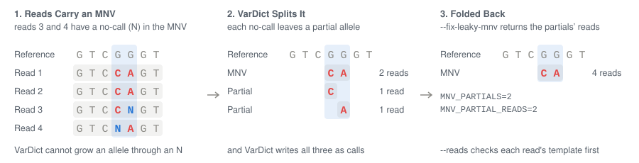

# vartovcf

[](http://bioconda.github.io/recipes/vartovcf/README.html)
[](http://bioconda.github.io/recipes/vartovcf/README.html)
[](https://github.com/clintval/vartovcf/actions/workflows/rust.yml?query=branch%3Amain)
[](https://coveralls.io/github/clintval/vartovcf?branch=main)
[](LICENSE)
[](https://www.rust-lang.org/)

Convert variants from VarDict/VarDictJava into VCF v4.2 format.


Install with mamba, conda, or run directly with pixi:

```bash
pixi exec \
    -c conda-forge -c bioconda \
    vartovcf --help
```

## Features

- Output is always coordinate sorted and normalized, and indexed when bgzipped
- Reads tumor-only and tumor-normal output, see [Tumor-Only](#tumor-only) and [Tumor-Normal](#tumor-normal)
- Applies FILTER labels only when asked, see [Filters](#filters)
- Folds an MNV's leaked partial alleles back into the MNV, judged by their reads, see [Leaky MNVs](#leaky-mnvs)
- Writes gVCFs with a record and depth at every position, see [gVCFs](#gvcfs)

## Tumor-Only

Replace the call to `var2vcf_valid.pl` with `vartovcf`:

```bash
vardict-java \
    -b "input.bam" \
    -G "hg38.fa" \
    -N dna00001 \
    -p \
    -c1 -S2 -E3 -g4 -z1 -f0.05 \
    "calling-intervals.bed" \
  | vartovcf \
      --reference "hg38.fa" \
      --sample dna00001 \
      --fix-leaky-mnv \
      --reads "input.bam" \
      --context-3mer \
      --fill-gvcf \
      --fill-gvcf-bed "calling-intervals.bed" \
      --output "dna00001.g.vcf.gz"
```

With `-p`, VarDict writes the sites without a variant too, and `--fill-gvcf` fills the positions VarDict leaves out, so every position of the BED gets a record.
VarDict then keeps every candidate variant call, so add the [Filters](#filters) you want.

## Tumor-Normal

Replace `var2vcf_paired.pl` the same way, naming the normal sample:

```bash
vardict-java \
    -b "tumor.bam|normal.bam" \
    -G "hg38.fa" \
    -N "dna00001|dna00002" \
    -c1 -S2 -E3 -g4 -z1 -f0.05 \
    "calling-intervals.bed" \
  | vartovcf \
      --reference "hg38.fa" \
      --sample dna00001 \
      --normal-sample dna00002 \
      --fix-leaky-mnv \
      --reads "tumor.bam|normal.bam" \
      --output "somatic.vcf.gz"
```

Each record gets INFO `VARDICT_STATUS`, VarDict's label such as `StrongSomatic` or `Germline`, and `TUMOR_NORMAL_FISHER_P`, the one-sided Fisher p-value that the allele is more of the tumor's reads than the normal's.
FILTER labels test the tumor only, so select somatic calls with these INFO fields:

```bash
bcftools view -f PASS -i 'INFO/VARDICT_STATUS ~ "Somatic" && INFO/TUMOR_NORMAL_FISHER_P < 0.05' "somatic.vcf.gz"
```

> [!WARNING]
> VarDictJava's tumor-normal mode stops at the first allele at a position that fails its call rules, so it never writes the alleles ranked below that allele, about 0.4% of rows.
> A fix is proposed in [joachimwolff/VarDictJava#4](https://github.com/joachimwolff/VarDictJava/pull/4).

## Filters

FILTER stays missing (`.`) until a filter option is given.
Then each call gets the labels it fails, or `PASS` when it fails none, while a record with no ALT allele, or whose tumor (or only) sample has no ALT reads, stays missing.

These filter options use the thresholds `var2vcf_valid.pl` applies by default.
`vartovcf` leaves out the script's extra conditions, such as applying its mapping-quality label `Q10` only below an `AF` of 0.8, and its strand-bias label `Bias` only when VarDict flags the ALT reads, but not the REF reads, as strand biased (`2;1`):

```bash
vartovcf \
    --reference "hg38.fa" \
    --sample dna00001 \
    --filter-near-read-end 8 \
    --filter-low-mean-mapq 10 \
    --filter-homopolymer-indel 13 --filter-homopolymer-indel-max-af 0.275 \
    --filter-tandem-repeat-indel 13 --filter-tandem-repeat-indel-max-af 0.2 \
    --filter-high-mean-mismatches 5.25 \
    --filter-same-read-position 0.35 \
    --filter-strand-bias 0.01 --filter-strand-bias-min-odds-ratio 5 --filter-strand-bias-max-af 0.25 \
    --output "variants.vcf.gz"
```

In pileup mode (`-p`), VarDict keeps every candidate variant call, so add these filter options too:

```bash
    --filter-low-af 0.05 \
    --filter-low-qmean 22.5 \
    --filter-low-hicnt 2 \
    --filter-low-dp 3
```

| Label | Applied when |
|---|---|
| `NEAR_READ_END` | `MEAN_DIST_TO_READ_END` is below the threshold |
| `LOW_MEAN_MAPQ` | `MEAN_MAPQ` is below the threshold |
| `HOMOPOLYMER_INDEL` | An indel or Complex call one base longer or shorter than REF sits in a homopolymer of at least the threshold's copies |
| `TANDEM_REPEAT_INDEL` | An indel or Complex call one unit longer or shorter than REF sits in a 2-6 bp tandem repeat of at least the threshold's copies |
| `HIGH_MEAN_MISMATCHES` | `MEAN_MISMATCHES` is above the threshold |
| `SAME_READ_POSITION` | 2 or more ALT reads all place the variant at one read position, at an `AF` below the threshold |
| `STRAND_BIAS` | `STRAND_BIAS_FISHER_P` is below the threshold |
| `LOW_AF` | `AF` is below the threshold |
| `LOW_QMEAN` | `QMEAN` is below the threshold |
| `LOW_HICNT` | `HICNT` is below the threshold |
| `LOW_DP` | `DP` is below the threshold |

The `-max-af` and `-min-odds-ratio` options narrow a label to calls below that `AF` or above that odds ratio.

## Leaky MNVs

VarDict builds a multi-nucleotide variant (MNV) from a read's nearby mismatches.
A read that ends inside the MNV, or has a no-call or low-quality base there, counts toward a shorter allele instead, a partial allele of the MNV.
Here reads 3 and 4 leave the partial alleles `G>C` and `G>A` beside the MNV `GG>CA`:



`--fix-leaky-mnv` folds partial alleles back into their MNV.
A folded record sums the ALT reads, recomputes `AF`, `GT`, FILTER and the Fisher p-values, and counts what it took in INFO `MNV_PARTIALS` and FORMAT `MNV_PARTIAL_READS`.

> [!IMPORTANT]
> Give `--fix-leaky-mnv` the BAM VarDict read with `--reads` whenever you can.
> Without the BAM, partial alleles are judged by their read count alone, so a real allele with few reads beside a deep MNV folds too.

> [!WARNING]
> VarDictJava folds a partial allele starting after the MNV's first base whenever the partial has fewer reads than the MNV, even an SNV of another haplotype, and writes no row for the SNV, so `--fix-leaky-mnv` cannot undo it.

#### Deciding Partials by Their Reads

With `--reads`, each read template of a partial allele is examined at the MNV's other changed positions:

| At those positions, the template has | The template is | Its reads |
|---|---|---|
| The MNV's ALT | The MNV's molecule | Move to the MNV |
| Another base | Another allele | Stay |
| A no-call, a low-quality base, or no read | Unknown | Follow the row's other reads |

A partial allele with reads left keeps only those reads, and FORMAT `MNV_MOVED_READS` counts the reads that moved.
Give tumor-normal BAMs as VarDict takes them, `"tumor.bam|normal.bam"`, and set these options to the values VarDict ran with:

| Option | VarDict's | Default |
|---|---|---|
| `--reads-base-quality` | `-q` | 22.5 |
| `--reads-min-mapq` | `-Q` | 0 |
| `--reads-exclude-flags` | `-F` | `0x504` |
| `--reads-max-mismatches` | `-m` | 8 |
| `--reads-mnv-gap` | `-X` | 2 |

#### Deciding Partials by Their Count

Without `--reads`, a partial allele folds when it carries the MNV's ALT bases and has few enough reads to be the MNV's leakage at `--leaky-mnv-rate`, 0.05 by default.
At that rate, an MNV folds a 1-read partial allele once the MNV has 2 reads, a 2-read partial allele at 6, and a 10-read partial allele at 101.
On this repository's test data, `GG>CA` has a 6-read and a 4-read partial allele beside `G>T`, another allele:

```bash
vartovcf --reference "tests/reference.fa" --input "tests/calls.leaky-mnv.var" --output "calls.vcf.gz"
bcftools query -r chr1:1100-1101 -f '%POS\t%REF\t%ALT[\t%AD]\n' "calls.vcf.gz"
```

```text
1100	G	C	196,6
1100	G	T	196,30
1100	GG	CA	.,200
1101	G	A	196,4
```

With `--fix-leaky-mnv`, both partial alleles fold back into the MNV, and `G>T` stays:

```bash
vartovcf --reference "tests/reference.fa" --input "tests/calls.leaky-mnv.var" --fix-leaky-mnv --output "folded.vcf.gz"
bcftools query -r chr1:1100-1101 -f '%POS\t%REF\t%ALT\t%MNV_PARTIALS[\t%AD\t%MNV_PARTIAL_READS]\n' "folded.vcf.gz"
```

```text
1100	G	T	.	196,30	.
1100	GG	CA	2	.,210	10
```

> [!TIP]
> To estimate your library's rate, run without `--fix-leaky-mnv` and, for MNVs with a few hundred reads, take each partial allele's `AD[1]` over the sum of its `AD[1]` and the MNV's.
> Set the rate at a high quantile of those fractions, such as the 99th.

## gVCFs

In pileup mode (`-p`), VarDict leaves some positions of its regions without a record.
`--fill-gvcf` writes a reference-only record at each such position, so every position has a record, and `--context-3mer` adds each record's reference 3-mer.
Here a homozygous deletion and reads that end at 1111 leave four positions to fill:


A filled record's INFO `GVCF_FILL` says where its depth came from:

- `ROWS`: reads VarDict counted there but wrote at another position, as for a deletion
- `SPANNED`: the reads of a deletion, MNV or Complex call spanning the position
- `NO_READS`: no reads

The figure is drawn from this repository's test data:

```bash
vartovcf --reference "tests/reference.fa" --input "tests/calls.fill-gvcf.var" --fill-gvcf --context-3mer --output "calls.g.vcf.gz"
bcftools query -r chr1:1106-1112 -f '%POS\t%REF\t%ALT\t%CONTEXT_3mer\t%GVCF_FILL[\t%AD\t%SITE_DP]\n' "calls.g.vcf.gz"
```

```text
1106	C	.	GCG	.	280	280
1106	CGGA	C	GCG	.	0,280	280
1107	G	.	CGG	ROWS	0	280
1108	G	.	GGA	SPANNED	0	280
1109	A	.	GAC	SPANNED	0	280
1110	C	.	ACC	.	250	250
1111	C	.	CCT	.	240	240
1112	T	.	CTC	NO_READS	0	0
```

`--fill-gvcf-bed` also fills the regions of VarDict's BED that no read covers.
Run VarDict with `-z1` so it reads the BED's starts as 0-based, and set `--fill-gvcf-bed-extend` to VarDict's `-x`; a mismatched region fails the run, naming the options that would match it.
VarDict must run without `-3`, which moves indels from where VarDict counted them.
Tumor-normal input is refused, as VarDict writes no reference-only rows for a pair.

## Site Depth

Every record carries FORMAT `SITE_DP`, the depth at its POS: the reads VarDict counted there as REF or any allele, plus those of deletions, MNVs and Complex calls spanning it.
`SITE_DP` is the same on every record at a position, so `uniq` leaves one line per position, and `SITE_DP` is complete only for pileup (`-p`) output.
Unlike `DP`, `SITE_DP` never counts the `N` bases VarDict's `-K` adds.

Take depths from the whole file, before leaving out any record:

```bash
# Depth at each position
bcftools query -f '%CHROM\t%POS[\t%SITE_DP]\n' "calls.g.vcf.gz" | uniq

# Total depth
bcftools query -f '%CHROM\t%POS[\t%SITE_DP]\n' "calls.g.vcf.gz" | uniq | awk '{n += $3} END {print n}'

# Depth by reference 3-mer, a mutation spectrum's denominators
bcftools query -f '%CHROM\t%POS\t%CONTEXT_3mer[\t%SITE_DP]\n' "calls.g.vcf.gz" | uniq \
  | awk '{n[$3] += $4} END {for (c in n) print c, n[c]}'

# Mutations with their context and ALT reads
bcftools query -i 'ALT!="."' -f '%CHROM\t%POS\t%REF\t%ALT\t%CONTEXT_3mer[\t%AD{1}]\n' "calls.g.vcf.gz"
```

## Development and Testing

The checks CI runs are cargo aliases, so they can be run locally before pushing:

```bash
cargo ci-fmt
cargo ci-lint
cargo ci-test
```
